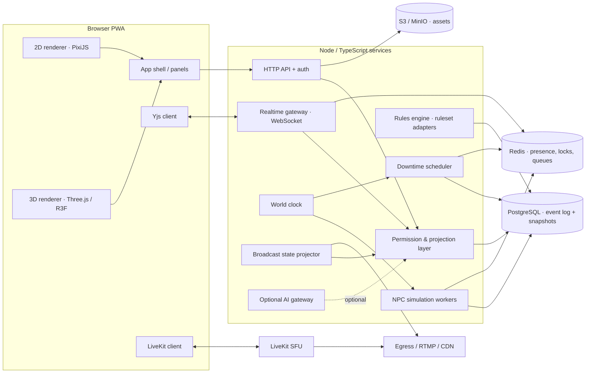
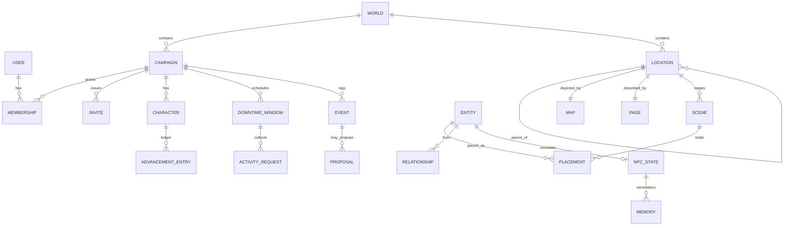

# Living World — Architecture

Status: design for the whole platform; **only §3 Identity, World and the location/map/page part of Spatial are implemented** (see `MILESTONES.md`). Everything else here is a design, not code.

## 1. Architecture diagram



Rule that holds the design together: **every byte that leaves the server passes through the permission & projection layer** (API responses, realtime events, search, exports, AI context, broadcast state). Clients never receive data they then hide.

## 2. Modules and interfaces

| Module | Owns | Interface (in) | Emits |
|---|---|---|---|
| identity | users, sessions, memberships, invites | `roleIn(user, world)` | `invite.*`, `user.*` |
| world | worlds, campaigns, settings, calendars | CRUD | `world.*`, `campaign.*` |
| knowledge | pages, links, backlinks, search index | CRUD, `search(q, viewer)` | `page.*` |
| spatial | locations, maps, scenes, pins, transitions | `view(location, viewer)` | `location.*`, `scene.*` |
| tabletop | tokens, fog, measurements, encounters | realtime ops | `token.*`, `encounter.*` |
| characters | characters, inventory, advancement ledger | commands | `character.*`, `xp.*` |
| rules | ruleset adapters (SRD 5.1, SRD 5.2.1) | `roll(formula)`, `apply(action)` | `roll.*` |
| clock | campaign time, modes, jobs | `advance(to)`, `checkpoint()` | `clock.*` |
| downtime | windows, activities, schedules, conflicts | proposals, resolutions | `downtime.*` |
| simulation | NPC state, schedules, goals, memories | `step(region, from, to)` | proposals + `npc.*` |
| approvals | proposed changes queue | approve/reject/edit/postpone | `canon.*` |
| comms | LiveKit room tokens, chat, whispers | `joinToken(user, room)` | `chat.*` |
| broadcast | spectator projection, camera allowlist | `project(state, spectator)` | broadcast frames |
| ai (optional) | provider adapters, budgets | `complete(ctx)` with projected ctx | suggestions only |

Modules communicate through the append-only event log plus direct calls inside one process. Splitting into processes is a deployment choice, not a code change.

## 3. Data model (ERD)

Implemented tables are **bold**; the rest are designed.



- **users** (id, name, token_hash) · **memberships** (user, world, campaign, role) · **invites** (code, campaign, role, accepted_by)
- **worlds** (id, owner, settings{ruleset, advancement, npcAutonomy, calendar, defaultVisibility}, root_location)
- **campaigns** (id, world, advancement{mode, source}) — the effective policy is copied at creation with its source, so a later world-default change never alters existing campaigns.
- **locations** (id, world, parent, type, x, y, visibility, map_id, page_id) · **maps** (id, location, image_url) · **pages** (id, location, title, body, gm_notes)
- **events** (seq, at, actor, type, data) — append-only; the basis for audit, replay and snapshots.
- Designed: `entities` (one row per NPC/item/faction/quest, typed JSON body + ruleset id), `placements` (entity in scene with xyz/rotation — never a copy of the entity), `relationships` (from, to, kind, weight, provenance_event), `characters`, `advancement_entries`, `downtime_windows`, `activity_requests`, `npc_state`, `memories` (npc, fact, provenance, scope), `proposals` (status, significance, payload), `snapshots`.
- Indexes (Postgres): `(world_id, parent_id)` on locations; `(campaign_id, game_time)` on events and activity requests; `GIN` on page tsvector filtered by visibility; `(region_id, next_wake_at)` on npc_state for the simulation queue; GiST on placements for spatial interest management.

Stable ids: every reference stores an id, never a name. Renaming is a field update (tested in `test/slice.test.js`).

## 4. Shared 2D/3D scene specification

```ts
type Vec3 = [number, number, number];          // metres; y is up; 2D uses y = elevation, plots x/z
interface Scene { id; locationId; units: 'm'; grid: { kind: 'square'|'hex'|'none'; size: number };
  layers: { terrain?: AssetRef; floorplan?: AssetRef; walls: Wall[]; lights: Light[]; zones: Zone[] };
  placements: Placement[]; fog: { mode: 'none'|'manual'|'los'; revealed: Polygon[] } }
interface Wall { a: Vec3; b: Vec3; height: number; door?: { state: 'open'|'closed'|'locked' }; blocksSight: boolean }
interface Placement { id; entityId; pos: Vec3; rotY: number; scale: number; collider?: 'capsule'|'box'|'mesh';
  visibility: 'gm'|'party'|'public'|{ users: string[] }; model?: AssetRef /* glTF */; token?: AssetRef /* 2D */ }
interface Zone { id; polygon: Vec3[]; trigger: Interaction[] }
```
- Both renderers read the same `Scene`; neither owns state. A 2D scene is a 3D scene with walls of default height.
- Line of sight and fog are computed **server-side** from walls; clients receive only revealed placements. Camera mode (top-down, iso, orbit, 3rd, 1st person) is purely a client view and cannot reveal more than the projection sent.
- 2D→3D conversion: GM traces walls over the floor plan → `Wall[]` with chosen height → editable geometry. Any automated detection only proposes walls.

## 5. Hierarchical map navigation (implemented)

- Locations form a tree rooted at the world's root location. Each location links to its own map (pins = visible children at x/y in 0..100) and wiki page.
- `GET /api/locations/:id` returns `{ role, location, breadcrumbs, map, page, children }` projected for the viewer: hidden children are omitted, `gmNotes` stripped for non-GMs, breadcrumbs stop at a hidden ancestor.
- Visibility tiers: `gm` < `party` (players) < `public` (players + spectators).
- Next: discovery state per campaign (`discovered_by[campaign]`), knowledge-dependent marker text, links from a pin to scene / NPC / quest / custom action, travel rules that advance the clock.

## 6. Characters and advancement

- World setting `advancement: milestone | xp` (implemented). Campaign stores `{ mode, source }` (implemented). Switching a campaign's mode requires `confirm: true`, keeps levels and history, and is logged (implemented).
- Character advancement is a ledger, not a field: `advancement_entries(character, kind: 'xp'|'level', amount, reason, source_event, approved_by)`. Level = f(ledger, thresholds) for XP; = count of approved level entries for milestone. Thresholds live in the ruleset adapter, overridable per campaign.
- Level-up is either `auto` or `requires_confirmation` (campaign setting). Quest completion awards a milestone only if the GM attached one to it.

## 7. Downtime and world clock

- One authoritative clock per campaign: `{ mode: paused|live|combat|travel|downtime|preview, gameTime: integer minutes since calendar epoch }`. Calendar math (custom weeks/months) lives in the calendar module; game time is never a JS `Date`.
- Only `clock.advance(to)` moves time. It enqueues idempotent jobs keyed `(campaign, region, fromTime, toTime)` processed in game-time order; a re-run is a no-op.
- Downtime window: start/end game time, real-world deadline (informational: never advances game time), allowed activity templates, limits, approval categories.
- Activity request: `{ character, template, start, duration, location, costs }`. Scheduler rejects overlapping intervals for the same character and reserves unique resources (artefact, NPC slot) with a row lock; the loser of a conflict is kept as `conflicted` for GM arbitration.
- Resolution modes: `manual` (GM), `assisted` (rules engine computes, GM approves flagged items), `auto` (only templates the GM marked low-risk). None require an LLM.
- Close: summary report from the event log; GM publishes → proposals become canon in one transaction.

## 8. NPC behaviour and simulation

- Layers: (1) schedule table per NPC/archetype, (2) reactive rules `when event → override activity`, (3) utility-scored goals, (4) optional AI suggestions. Layers 1–3 are deterministic given a seed.
- Level of detail: active scene → per-tick pathfinding on navmesh; loaded settlement → schedule lookups at clock ticks; offscreen → event-step jumps (`next_wake_at`); inactive campaign → nothing runs.
- Cost guard: NPCs are rows, not processes. Work happens only inside `clock.advance` jobs, bounded per region per job.
- Significance gate: routine → apply; minor → apply + audit; major → `proposal`; protected → rejected. Thresholds per world, overridable down to NPC.
- Knowledge: memories carry provenance and scope; dialogue/AI context is assembled only from the NPC's memories plus public canon, via the same projection layer.
- Preview: run `advance` against a forked snapshot, show diff, commit or discard.

## 9. Spectator security

- Spectator is a server role (implemented: sees only `public` locations, no gm notes, no write routes).
- Broadcast output is a **separate projection**: `project(state, spectatorPolicy)` builds a new object from an allowlist (scene id, public placements, public rolls, permitted HP bars, turn order). Nothing is filtered by CSS.
- Camera: spectators get named camera presets the GM enabled; no free camera, since free camera over unprojected data is the classic leak.
- Leak tests: for each fixture, assert the broadcast and spectator payloads contain none of the GM-only strings (pattern already used in `test/slice.test.js`).

## 10. Realtime communications and streaming

- Realtime game state: WebSocket gateway, one channel per scene; Yjs for collaborative docs (wiki); server-authoritative ops for tokens/dice. Each outbound event goes through projection per recipient role.
- Voice/video: LiveKit SFU. Server mints room tokens with grants by role (spectators: subscribe-only, or not in the room at all). GM channel and whispers are separate rooms/data topics.
- Streaming: v1 = `/broadcast/:campaign` page captured by OBS. v2 = LiveKit Egress → RTMP to the streaming service; large audiences watch via that service's CDN, never the player SFU room.
- Recording/transcription and any third-party AI call require per-participant consent records before enabling.

## 11. Deployment

- Today: `node server.js` (no dependencies), JSON file store. Docker: `node:22-alpine`, copy folder, `CMD node server.js`.
- Target: Postgres + Redis + MinIO + LiveKit via docker-compose for self-hosting; same images for cloud.
